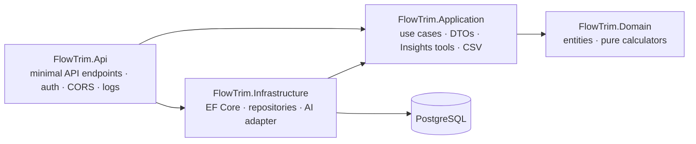

<div align="center">

# FlowTrim API

**The deterministic engine behind FlowTrim: every recurring charge, its real monthly cost and what you would save by cutting it.**

[](https://github.com/Andermc10/FlowTrim-backend/actions/workflows/ci.yml)


[Frontend](https://github.com/Andermc10/FlowTrim-frontend) · [Specs & backlog](https://github.com/Andermc10/FlowTrim-tracker) · [Operations runbook](https://github.com/Andermc10/FlowTrim-tracker/blob/main/docs/OPERATIONS.md)

</div>

---

## Why it is different

| | |
|---|---|
| **Numbers you can audit** | Monthly equivalents, projections, savings and cost per use come from pure, unit-tested C# formulas. Currencies are never summed or converted. |
| **Honest by design** | Expected charges are never presented as payments, declared usage is never "verified", the simulator cancels nothing and always returns its assumptions. |
| **Private per user** | Every query is filtered by the token's `sub` on the server. Another user's data answers `404`, exactly like a missing id. |
| **AI that cannot invent figures** | Insights lets a model call five read-only tools; the figures in the response are built by the backend, never parsed from the model's text. |

FlowTrim is a **manual-data** portfolio project: it does not connect to banks, detect charges or cancel anything.

## Features

- **Subscriptions** — CRUD with paging, server-side countdown and alert windows (overdue · today · ≤3 · ≤7 · later).
- **Spending** — per-currency summary, analytics (by category, top 5, expected charges per month) and a cancellation simulator at 1/12/24 months.
- **Usage** — declared usage records and cost per use that never divides by zero.
- **CSV in and out** — export (RFC 4180, formula-injection guard) and a two-step import: preview with per-row errors and duplicates, then an atomic confirmation.
- **Insights** — short questions about your own data answered from deterministic tools (Groq free tier or an offline fake).
- **Operations** — health check, RFC 7807 errors with a correlation id, JSON logs without personal data, validated configuration that fails fast.

## Architecture



A layered modular monolith: project references enforce the dependency rule, `Domain` depends on nothing and EF entities never leave the backend (the API speaks DTOs only). Endpoints are grouped by area in `src/FlowTrim.Api/<Area>/*Endpoints.cs`.

## Quick start

Requirements: [.NET 10 SDK](https://dotnet.microsoft.com/), [Docker](https://www.docker.com/) and an OIDC tenant (Auth0 free works).

```bash
cp .env.example .env                 # local PostgreSQL credentials (never committed)
docker compose up -d --wait          # PostgreSQL 17 on POSTGRES_PORT

dotnet user-secrets set "ConnectionStrings:FlowTrimDb" "Host=localhost;Port=5432;Database=flowtrim;Username=flowtrim;Password=<password>" --project src/FlowTrim.Api
dotnet user-secrets set "Authentication:Authority" "https://<tenant>.<region>.auth0.com/" --project src/FlowTrim.Api
dotnet user-secrets set "Authentication:Audience" "https://api.flowtrim.dev" --project src/FlowTrim.Api

dotnet tool restore
dotnet ef database update --project src/FlowTrim.Infrastructure --startup-project src/FlowTrim.Api
dotnet run --project src/FlowTrim.Api --launch-profile http   # http://localhost:5214
curl http://localhost:5214/api/health
```

Migrations are never applied automatically: review the SQL, then run the command above.

## API at a glance

Every route except `/api/health` needs a bearer token (`401` without it, `403` if it has no `sub`).

| Area | Routes |
|---|---|
| Health | `GET /api/health` → `200` or `503`, no internals |
| Subscriptions | `POST · GET /api/subscriptions` · `GET · PUT · DELETE /api/subscriptions/{id}` · `GET /api/subscriptions/upcoming` · `POST /api/subscriptions/{id}/mark-paid` |
| Usage | `POST · GET /api/subscriptions/{id}/usage-records` · `GET /api/subscriptions/{id}/cost-per-use?from=&to=` |
| Spending | `GET /api/summary` · `POST /api/simulations` · `GET /api/analytics?months=12` · `GET /api/reports/subscriptions.csv` |
| Import | `POST /api/subscription-imports/preview` · `POST /api/subscription-imports/confirm` (multipart `file`) |
| Insights | `POST /api/insights/questions` (5 per minute per user, 45 s budget) |
| Accounts | `GET · POST /api/accounts` (`?includeArchived=true`) · `GET · PUT · DELETE /api/accounts/{id}` — balance computed from transactions |
| Categories | `GET · POST /api/categories` (`?kind=Expense|Income`, `?includeArchived=true`; the first list creates a default set in the `Accept-Language` language) · `PUT · DELETE /api/categories/{id}` |

Errors are RFC 7807 `ProblemDetails`: `400` with field errors, `404`, `409` with a `code` for business conflicts (deleting an account or category that has transactions, changing an account's currency or a category's kind), and a generic `500` that never leaks stack traces or connection strings. Every response carries `X-Correlation-ID`; error bodies repeat it as `correlationId`, and the import and Insights errors add a stable `code`.

<details>
<summary><b>Import rules</b></summary>

Same format as the export, so an exported file imports again: `.csv`, UTF-8 (BOM allowed), at most 256 KB and 500 rows; required `name, amount, currency, billing_cycle, next_billing_date` (today or later), optional `category, status`. Excel's semicolon files (decimal comma, `dd/MM/yyyy`) and a `sep=` first line are also accepted. A row that repeats one of your subscriptions (same name ignoring case, same currency) or an earlier row is a `duplicate` and is never created. Confirmation re-sends the same file, re-checks everything inside one transaction serialized per user (`pg_advisory_xact_lock`) and is idempotent. Full reference: [SUBSCRIPTION-CSV-FORMAT.md](https://github.com/Andermc10/FlowTrim-tracker/blob/main/docs/SUBSCRIPTION-CSV-FORMAT.md).

</details>

<details>
<summary><b>Insights and privacy</b></summary>

The model only sees the question, the tool definitions and tool results for the signed-in user (names, amounts, dates, declared usage). It never receives ids, the user's `sub`, tokens or keys. Nothing is stored and logs hold metrics only. `Insights:Provider:Kind` is `Fake` by default (offline, used by CI); `OpenAiCompatible` works with Groq, OpenRouter or Gemini by configuration. Free tiers may retain prompts, so use demo data only. Verification matrix: [INSIGHTS-VERIFICATION.md](https://github.com/Andermc10/FlowTrim-tracker/blob/main/docs/INSIGHTS-VERIFICATION.md).

</details>

## Configuration

Development uses `appsettings.Development.json` plus User Secrets; deployments use environment variables (`Section__Key`). Validation runs at startup and error messages never print values.

| Setting | Required | Secret | Notes |
|---|---|---|---|
| `ConnectionStrings:FlowTrimDb` | Always | **Yes** | Npgsql connection string |
| `Authentication:Authority` / `Audience` | Always | No | OIDC issuer and API audience; `RequireHttpsMetadata` defaults to `true` |
| `Cors:AllowedOrigins` | Outside Development | No | Exact `https://` origins only (`Cors__AllowedOrigins__0`, …) |
| `Insights:Provider:Kind` | No | No | `Fake` (default) or `OpenAiCompatible` |
| `Insights:Provider:BaseUrl` / `Model` / `ApiKey` | With `OpenAiCompatible` | Key: **Yes** | e.g. `https://api.groq.com/openai/v1`, `openai/gpt-oss-120b` |
| `Insights:RequestTimeoutSeconds`, `Insights:RateLimit:*` | No | No | 45 s; 5 questions per 60 s |

Outside Development the API enables HTTPS redirection and HSTS, writes JSON logs and keeps SQL text out of them.

## Tests

```bash
dotnet test FlowTrim.slnx                                    # 560 tests (needs Docker for the PostgreSQL ones)
dotnet test FlowTrim.slnx --filter "Category!=Integration"   # fast tests only, no Docker
```

- **Unit** — domain formulas, rounding, alert windows, CSV parsing and duplicate rules, Insights tools.
- **HTTP** — the real API through `WebApplicationFactory` with a fake auth scheme: `401`/`403`, owner isolation on every private route, fail-fast configuration, logs without personal data.
- **PostgreSQL** — [Testcontainers](https://dotnet.testcontainers.org/) (`postgres:17-alpine`) with the real migrations: constraints, repositories, atomic and concurrent imports.

CI (`.github/workflows/ci.yml`) runs the Release build and every test on each pull request, with no secrets. `main` is protected: a red check cannot be merged.

## Known limitations

- Manual data only: no bank integration, no charge detection, no usage verification.
- No currency conversion; every total is per currency.
- Projections and savings assume constant prices and are never guaranteed.
- No public deployment yet: the demo runs locally.

Deferred items: [docs/TECH-DEBT.md](docs/TECH-DEBT.md) · v0.1.0 self-review: [docs/RELEASE-REVIEW.md](docs/RELEASE-REVIEW.md).
